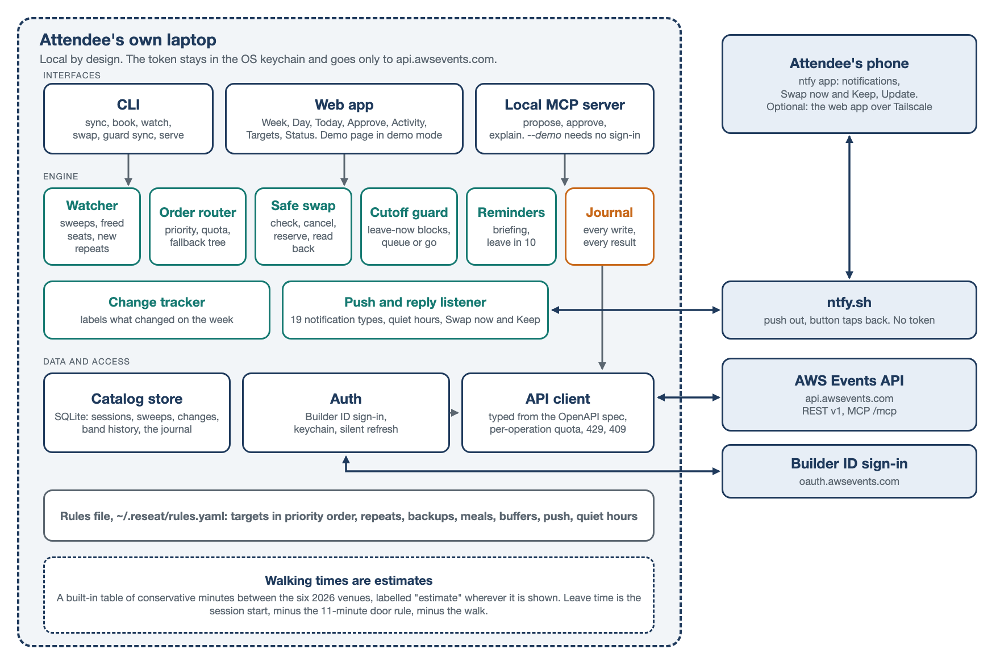

# How re:Seat works

re:Seat manages an attendee's AWS re:Invent seats after the plan is made. It watches for freed seats and newly added repeat sessions, books them within the attendee's rules, upgrades held seats without losing one, and tells the attendee when to leave and whether to queue.

It runs on the attendee's own machine against the [AWS Events API](https://docs.aws.amazon.com/events/latest/devguide/what-is-events-api.html). It keeps a journal of every write and its result. The CLI, a web app served from the laptop (Week, Approve, Today and Activity), and a local MCP server all drive the same engine.

Each part below is marked **built**: it is in this repo and tested against the fake API. Checks run against the real API are in [proof/](proof/).

## The problem, in attendees' words

Quotes are from public Reddit threads, personal blogs and Builder Center posts, 2022 to 2026.

| Pain | First-hand account |
|---|---|
| Seats vanish on opening day | "Most things were full by 10:03am." (2022) "I didn't get anything I wanted even 3 hours after it went live." (2023) |
| Seats free up later | "Some stuff that was full yesterday I was able to reserve right now." (2024) |
| Capacity gets added | "The more popular sessions get 2-3x extra sessions once they get booked up." (2022) "They continue to add repeat sessions and adjust the schedule." (2025) |
| Refreshing in the queue | "Get in line and keep refreshing the app for the associated session. Most of the sessions will have no shows or cancellations." (2022) |
| The 10-minute rule | "Use 11 minutes as I have found myself arguing with the staff." (2025) "I was at the 50th person on the walk-up line. They only accepted 20 more walk-ups." (2023) |
| Venue distance | "Don't do one session at Venetian followed by a session at MGM. You'll never make it." (2022) |

Two things were not found in first-hand reports, so re:Seat does not claim them: a reserved session changing room or time after booking, and anyone losing both seats during a swap. The portal offers a Keep Existing or Replace choice on conflicts. The API does not. re:Seat restores that safety for API users.

## What the API gives, and what shapes the design

Full detail, with sources, is in [api-facts.md](api-facts.md).

- **Local only.** OAuth 2.0 code flow with PKCE, callback on localhost ports 8484 to 8489. No hosted redirect.
- **No search.** re:Seat pulls the whole catalog, about 2,300 sessions in 10 pages, and works locally.
- **Seat bands, not counts.** `available`, `limited`, `veryLimited`, `unavailable`, `walkUp`. A band change is the signal that a seat freed.
- **Partial success.** Reserve and favorite return 200 with a `failed` list. Unknown failure codes are treated as generic refusals.
- **No blind retry.** A repeated reserve reports `alreadyScheduled`. Cancel on a seat not held is a 404 in the spec and was a 400 in the live API when checked on 12 October, and the read-back decides. Every write is followed by a `GetSchedule` read-back.
- **Quota counts sessions.** Ten reserves in one call spend 10 of the 30 per minute.
- **No swap.** Reserving a session that overlaps a held one is refused. Cancel must come first. That is the risk re:Seat manages.
- **Two-day gap.** The portal opens reserved seating on 6 October 2026. API writes open on 8 October. re:Seat cannot help with the first rush.
- **Time zones.** Sessions are Las Vegas local time. Personal time is UTC.

## What re:Seat does

**Favorites** (built)
- `reseat favorites sync` mirrors every target sitting, and each backup's sittings, into favorites, so the official app shows the same plan. Works before 8 October, when reservations are still closed. When a target is dropped, the favorites re:Seat added for it are removed with DisassociateFavorite, one call each. Which favorites re:Seat added comes from its own journal: only sessions an AssociateFavorites result listed as successful. Only rows written by `favorites sync` count, and only while its own read-back listed the session. A favorite the attendee added, in the app or with `reseat favorite`, a batch whose answer was lost even if it landed, and any session the attendee holds a seat in are never removed. While any target is missing from the local catalog, nothing is removed. A 404 means the favorite is already gone, and it is recorded and never sent again. A removal the read-back still lists stays, and is not sent again. One case the journal cannot see: a favorite re:Seat added, removed by the attendee and then added again by hand, still counts as re:Seat's. `--no-prune` keeps them all. `--dry-run` shows both lists.
- `reseat whoami` and `reseat sync` first read the event with GetEvent. Session times carry no time zone, so re:Seat checks that the event is in America/Los_Angeles and runs 30 November to 4 December 2026, the zone and days every leave time and day name is built on. Anything else is refused before the catalog is read. It uses the IANA zone, not the abbreviation, which the live API gives as PDT for this December event.
- Skips sessions already favorited, sends 10 per call inside the quota, reports each failure, and reads back once at the end.

**Book** (built)
- Targets live in a rules file in priority order, with allowed repeats and backups. Each target has a fallback tree.
- Books in batches of up to 10 inside the 30 per minute budget. On `sessionFull` it moves to the target's next sitting in the same run.
- Formats that are not recorded fill first, so they are sent first: Workshop, Lab and Bootcamp, then Builders' session, Chalk talk, Code talk, Breakout session, then the rest.
- Never holds two sittings of one talk. Never books over a held session, a meal in the rules or the daily cap.
- Reads back `GetSchedule` after every write and journals request, response and read-back.

**Watch** (built)
- `reseat watch` sweeps the catalog about once a minute without abstracts and records every seat band change. The interval has a 30-second floor.
- Diffs each sweep to catch new sessions and new repeats, and books a target's new sitting the moment it appears. Planner imports list the sittings known on export day. A repeat added later still counts.
- When a freed sitting overlaps a held session of a lower-priority target, it proposes a swap with a random plan id instead of booking. Plan ids expire after 10 minutes and work once. It never proposes cancelling a seat the rules do not cover.
- A booking that fails for a reason that is not an answer about the seat, such as a server error, is tried again on the next sweep.
- A 409 means writes are switched off. The watcher keeps sweeping and keeps every opening queued, but sends no reserve and runs no swap for 15 minutes, then tries once. With a `probe_session` that can never be held, it checks every minute and resumes the moment writes open. It reports paused and resumed once each, and push carries both. A 409 between a swap's cancel and its reserve stops the swap at once and says the released seat needs reserving again.
- It proposes a swap only when replacing that one held seat would free the slot, so it never proposes a swap that cannot run.
- Autopilot. On the first normal sweep after start, and after the rules file changes on disk, a catch-up pass books every target already open, in rule order, through the same router, read-back and journal. A first load or a re-keyed catalog is a baseline and books nothing. Clashes found by the catch-up are not pushed. The rules file is re-read when its size, time, inode or mode changes, so fixing its permissions alone is picked up. A file that does not load or exceeds `watch_cap` is refused, the old rules stay, and an error event says so. Each reload is journaled as `watcher.rules`. A target with `auto_swap: true` swaps up on its own through `swap.py`, which reads both sessions fresh and checks a way back first. `serve_secret`, `ntfy_topic`, the ntfy buttons and the SNS topic are fixed at start. A reload drops pending proposals whose seats are no longer targets, refuses a symlinked file or one that others can write or another user owns, and is pushed and emailed.
- Warns when a held session moves room, venue or time. It does not act.
- The first sweep into an empty catalog is a baseline. Initial booking is `reseat book`.
- A sweep that comes back empty, falls short of the API's own `totalCount`, or would drop most of the catalog without bringing back one of about the same size, is refused and the local catalog kept. A catalog of about the same size with mostly new ids is recorded as a new baseline, not as thousands of new sessions. Nothing is booked while a held session is missing from the local catalog. Seen live on 8 October: see [proof/](proof/).
- Survives outages. A refused connection, a timeout or any 5xx never ends the loop. The wait between sweeps doubles from the normal interval up to 5 minutes and drops back on recovery. A sweep that fails halfway is not saved, so no opening is lost. Each outage is journaled.
- After 10 minutes down it reports `offline`, and `back` on recovery. A failed token refresh reports `signin` once and switches to read-only until a sweep works again.
- Emits typed events (sweep, booked, proposed, swap, moved, removed, unconfirmed, not_booked, catalog, error, outage, offline, back, signin) to any subscriber. A not_booked event carries the router's reason, and is not raised for a sitting that is simply full, for a talk already held, or after a 409. The CLI prints them. The web app subscribes the same way.
- Keeps the attendee's personal time from the GetSchedule read each sweep already makes, in memory, for the Today view. No extra call.

**Swap** (built)
- Before replacing held session A with wanted session B, checks: B is open in a fresh `GetSession` read and takes reservations, A has a fallback (A's own band open, or another sitting of A open and free of clashes), B repeats no held code and overlaps no held session but A, and the attendee allowed auto-swap for this target or approves now.
- Cancels A. If the cancel fails and A is still held, stops there. Otherwise reserves B at once and reads back. If B fails, re-reserves A. If A is gone, tries each fallback once and prints a loud alert with what is held now. If a read-back fails mid-swap, it sends nothing more and says the state is unknown. If any reserve after the cancel returns 409, it sends nothing more and says A was released. Bands are read fresh. Session times for the clash checks, and the list of A's other sittings, come from the last sync.
- States: proposed, checked, cancelled, reserved, verified, rolled back, failed. Every state is journaled, and every write before and after it is sent. A read that fails during the checks is journaled as failed, and nothing is cancelled. One swap in flight at a time, across processes.
- Ask first by default. Auto mode is opt-in per target. `reseat swap <held> <wanted>` and the watcher use the same code.

**Guard** (built)
- `reseat guard sync` writes a 5-minute leave-now block into personal time for each held session, from venue walking times, an 11-minute cutoff and the attendee's buffer. The first walk of a day starts at `home_venue` from the rules file.
- Creates, updates or deletes blocks to match current holds. A second run sends nothing. It only touches its own entries, whose description starts "Leave now by reseat." and ends "Set by reseat". Entries in the earlier `[reseat]` form are still recognised. Descriptions avoid `: ( ) [ ]`. The live API refused a description holding all five and accepted it without them.
- Warns when the walk between two held sessions is longer than the gap.
- Queue or go: for a session not held, advice from session type, overridden by that session's band history once it has three changes. Presented as a heuristic with its basis, never a prediction. The web app's Today view shows it.

**Web app** (built)
- The token never leaves the laptop, because the API only allows sign-in on the attendee's own machine. So the laptop runs the watcher and serves a local web app in its own browser. The phone gets ntfy notifications and approves a swap from the notification. Opening the web app on the phone is optional, over Tailscale.
- Views rendered on the server from the store, the journal, the rules, the guard, the watcher and the change tracker. Week (`/`): swaps waiting for approval with their checks and the swap's sequence, what just changed, and the week grid (held, wanted, proposed, fallback, leave-now strips, walk-over-gap badges labelled as estimates, a current-time line, change labels for 15 minutes, ghosts of released seats). Day (`/day`): one day in full. Approve (`/approve`): one proposal at a time, both sides and the checks, beside the seats booked today. Today (`/today`): the leave-in countdown with the estimated walk and the doors-close time, the rest of the day with the attendee's own personal time, and wanted sessions with queue-or-go advice and clashes. Activity (`/activity`): counts, changes and the journal. Findings (`/findings`): what the watcher saw, from `findings.py`: openings on full sessions by day and type, how long until each was full again, sessions added, seat bands now, sweeps and outages. Counts by type and band only, never a code, title, room or time, so `reseat findings --json` can be published, and `scripts/build_site.py` renders that file as a page on the demo site. Targets and Status. One menu on every page. Pages fit the screen.
- Bookings within the rules happen at once, so only swaps and Book offers wait. Swap now runs `swap.py`, which reads both sessions fresh again before any cancel.
- Book offers (`offers.py`): after a sweep, a session just added, or a seat that opened on a favorite, that is not a target and fits around the held seats, becomes an offer with its own plan id, at most five per sweep, plus one summary of the new sessions. Targets are left to the rules. Book takes the plan id, reads GetSchedule and GetSession again, checks the band, clashes, a second sitting of a held talk, meals and the daily cap, then sends one ReserveSessions through the router's `execute`, which reads back and journals. Any check that fails sends nothing. When the API did not answer a check, or writes are closed (409), the offer is kept for another tap. When a check refused it, the offer ends and a push says why.
- Week and Activity count, from the journal, the seats booked, swaps verified and seats restored. Pages follow the system's light or dark setting.
- One CSS file and one JavaScript file served by `serve.py`. System fonts, no framework, no CDN, no build step. The script polls `/api/state` every 10 seconds and reloads when a proposal or a sweep changes.
- `reseat serve` listens on `127.0.0.1:8490` by default. Binding to any other address needs `serve_secret` in the rules file, or it refuses to start. It never binds every interface: `0.0.0.0` is refused. `--tailscale` binds 127.0.0.1 and has Tailscale Serve forward the laptop's tailnet name to it, removing the forwarding on exit. It needs `serve_secret`, since anyone on the tailnet could reach it. Started on a reachable address, the server checks it can reach itself and says what to change if not. The phone opens a one-time link, printed on the laptop, that sets a cookie and redirects to a clean URL. The link carries a single-use code, never the secret. To sign in again, the phone posts the secret in a form, rate limited.
- Writes need the cookie and an `X-Reseat` header, which a cross-site form cannot send. Without a secret on loopback, the Host header must be the loopback address. Not a security product: it stops a neighbour on hotel Wi-Fi from approving swaps.
- Swap now and Dismiss take a plan id that expires after 10 minutes. No endpoint accepts a raw session id, and no page or JSON response shows one.
- Optional push through ntfy, off unless a topic is set. Seat booked, seat opened but not booked with the reason, booking not confirmed, a held session moved or removed, swap proposed, done or rolled back, catalog back, offline, back, writes paused or resumed, sign in needed. While the web app runs, `reminders.py` adds, each sent once: a swap proposal 2 minutes from lapsing (with its buttons), a target pinned to its own sittings (`repeats: false`) that is full while another sitting has seats, two held sessions with a walk longer than the gap, and the on-site reminders from the local store: the morning briefing (06:00 to 10:00 Las Vegas time on a conference day), leave in 10 minutes, leave now, and a wanted session without a seat starting in 20 minutes with queue-or-go advice. They open the Today view. When the leave-now blocks re:Seat wrote earlier no longer match the holds, the web app offers one Update, as a push button and on Today, with a single-use token for that difference. It runs the same `guard sync`, which reads the schedule, writes, and reads back. Messages carry session codes, titles and the event type only, plus a link to the page to open when the server listens on a reachable address such as the Tailscale one. Never a token, an abstract or a session id.
- Email and text alerts (`sns.py`), opt in with `sns_topic_arn`: the same words as the push, for Book offers, bookings, swaps, a held session moved or removed, sign-in needed and offline, published to an SNS topic in the attendee's AWS account on a background thread. Credentials come from boto3's usual chain or `aws_profile`. re:Seat stores no AWS keys. A failed publish is counted and the error kept only by type. Optional extra `reseat[aws]`.
- Approve from the notification, opt in with `ntfy_approve: true`: a swap proposal push carries Swap now and Keep buttons, and, opt in with `ntfy_book: true`, a Book offer Book and Dismiss buttons, at most 3 bookings a day from the notification, that post `approve <plan id>` or `skip <plan id>` to a reply topic derived from the push topic. A listener on the laptop reads that topic over one outgoing streaming connection, acts only on those two commands, starts from the time it started, and handles each plan id once. Approving runs the same plan-id path as the web app.
- A web app manifest and icon let the phone add re:Seat to its home screen and open it full screen.
- On site the laptop checks the day's held and wanted sessions with GetSession every 20 seconds, at most 40 of them, inside the 120 per minute quota. A freed seat is booked the moment it shows.
- One thread owns the API client and the local store. The web server only reads a snapshot it builds and hands approvals to it. Stopping the server lets a swap in progress finish first.
- Wrong secrets at `/login` are limited to 5 a minute per device address and 30 a minute in all. Behind `--tailscale` the device address is the last `X-Forwarded-For` entry, the one the proxy adds, used only when the request comes from loopback. A sign-in lasts 7 days. Sign-ins live only in the running process, so a restart signs every device out. The page is plain HTTP: use it over Tailscale.
- Demo mode, `reseat serve --demo`: the same server, watcher, router and swap on FakeEventsApi with a week of real sessions from the 1 October catalog and a scripted timeline (a seat opens, a new sitting appears, a room moves). The store is in memory. It never reads the keychain or `~/.reseat`, and every page says "Demo data". A **Demo** page, `/demo`, in demo mode only, has twenty-two scenarios and a guided tour. Each changes the fake API (a seat opens or fills mid-swap, a repeat appears, writes close and reopen through the probe session, the API drops, the catalog empties, sign-in expires) or moves the demo clock forward to an on-site moment, and runs one real sweep. Beside the list it shows what AWS did, what re:Seat did, the week before and after for each day touched (the net change, start against end, so a rolled-back swap is no change), and each notification as the phone shows it. Its endpoint, `POST /demo/<name>`, needs the same cookie and header as Approve and does not exist on a real server. `--push <topic>` turns on the same ntfy push as the real server, with demo codes and titles. `scripts/build_site.py` renders the same views to static HTML, including the Week page after a real swap on the fake, for the click-through demo on GitHub Pages.
- Designed for a laptop left in the hotel room, plugged in and awake. The phone gets ntfy notifications. Opening the web app on the phone over Tailscale is optional. See "Running it all week" in the README.

**Interfaces**
- CLI (built): `login`, `whoami`, `sync`, `search`, `show`, `schedule`, `findings`, `favorite`, `favorites sync`, `probe`, `rules`, `book`, `cancel`, `watch`, `swap`, `guard sync`, `serve`, `mcp`.
- Web app (built), as above. `reseat serve`. The same engine as the CLI and the MCP server.
- Local MCP server (built): `reseat mcp`, over stdio. Eleven tools: `list_targets`, `propose_changes`, `propose_swap`, `approve_changes`, `explain_drift`, `guard_sync`, `queue_or_go`, and the planning tools `search_sessions`, `open_slots`, `check_plan` and `draft_rules` from `planning.py` (built). Planning answers are in start-time order, never by merit. `search_sessions` reads the local catalog only, at most 50 rows. `open_slots` reads GetSchedule once and checks each walk in and out with the same allowance and 11-minute door rule as leave-now blocks. Catalog text reaching the AI has control and hidden characters removed. `check_plan` reads GetSchedule once and states facts per code against what is held and the rest of the list, with no pass mark. A walk is checked from whatever ends last before the session to whatever starts first after it. `draft_rules` returns a plan id and the full resulting target order. A code with -R pins that sitting, a code without -R is any sitting of the talk, and a talk already a target is not added twice. It edits the target lines of the rules file as text, so comments and every other setting are kept, then parses the result and refuses unless only the targets changed as intended. `approve_changes` writes it only if the file is unchanged since the draft, keeps a `.bak`, and sends nothing to the API. Drafted targets have `auto_swap: false` unless named in `autopilot`. Autopilot is opt-in per target. A code in `autopilot` is added in the same draft or is already a target, else nothing is drafted. For an existing target only `auto_swap` is turned on, and the check refuses any other change. The answer names every target that may swap on its own. Removing a held target stops watching it and never cancels. `propose_swap(held_code)` finds an open sitting of a held talk that the rules put first, runs the swap's checks with fresh reads, and returns a plan. Approving it runs `swap.py`. The proposal's journal record ends as `planned` or `declined`. Nothing is sent until the approve. Every change is two steps. A propose returns a plan id and sends nothing. `approve_changes(plan_id)` carries it out once, within 10 minutes, and reserves only what the plan named. Calls run one at a time. Before each call the server re-reads the rules file if its time, size, inode or mode changed, without following a link, with the watcher's checks: a file that does not load, exceeds `watch_cap`, is a symbolic link, belongs to another user or that others can write keeps the old rules, and that call's answer starts with why. Any change drops every pending plan, so nothing proposed under the old rules can be approved. A reloaded file holding a secret that others can read gets the same warning as at start. A leave-now plan is refused if holds changed after it was shown. No tool takes a list of session ids. The approval step is an instruction to the agent, not something the server can enforce.

## Architecture

| Component | Status | Responsibility |
|---|---|---|
| Auth | built | PKCE on port 8484, fallback to 8489. OS keychain. Refresh once on 401. Sign-out with revoke. The token is only ever sent to `https://api.awsevents.com`. A dropped connection or a failed refresh on a write is read back like a server error. |
| API client | built | Typed models that mirror the OpenAPI spec. Quota tracker per operation. Honors `Retry-After` once. Per-session failures as typed results. |
| Catalog store | built | SQLite. Full sync, then cheap sweeps. Added, removed and moved sessions. Band history. Write journal. |
| Campus | built | The 2026 venues, a walking-time table, Las Vegas to UTC conversion. |
| Rules | built | `~/.reseat/rules.yaml`. Targets come from the official schedule (reserved first, then favorites, by session id) or a reinvent-planner.cloud export. Validation against the catalog. |
| Order router | built | Priority, quota, fallback trees, scarcity ordering, read-back. |
| Cancel | built | `GetSession` first, ask first, one DELETE, read-back. |
| Watcher | built | Sweep loop. Books freed and new sittings through the router. Proposes swaps. Typed events to subscribers. |
| Safe swap | built | State machine: proposed, checked, cancelled, reserved, verified, rolled back, failed. |
| Cutoff guard | built | Leave-now blocks, queue-or-go advice, venue-switch warnings. |
| Decisions | built | `decisions.py`: walk-up odds as a Beta-binomial with an 80 percent range, and the walking allowance as a lognormal quantile at `arrive_confidence`. Sources and formulas in [The models behind re:Seat](models.md). |
| Favorites sync | built | Mirror target sittings into favorites, remove the ones re:Seat added for dropped targets (never the attendee's own, never a held seat), read back once. |
| Web app | built | Local HTTP server: Week, Day, Approve, Today, Activity, Findings, Targets and Status views, Book offers, a change tracker (`changes.py`) that labels what changed on the week, approve by plan id, demo mode, on-site polling, optional push. |
| Reminders | built | `reminders.py`: morning briefing, leave in 10 minutes, leave now, a wanted talk soon, a swap offer about to lapse, a walk you cannot make, an exact sitting full while another has seats. Each once, from the local store. Sent ones are saved there too, so a restart never repeats one. |
| Change tracker | built | `changes.py`: compares held and proposed sessions at each refresh and labels what changed on the week. The first look is a baseline. |
| Push | built | `push.py`: ntfy pushes with codes and titles only, quiet hours and muted categories, Swap now, Keep, Book, Dismiss and Update buttons read back over a derived reply topic. `sns.py`: the same alerts to an SNS topic for email and text. |
| Findings | built | `findings.py`: read-only counts from the store. Baseline sweeps are left out. |
| MCP server | built | Eleven tools: `search_sessions`, `open_slots`, `check_plan` and `draft_rules` to plan, with no ranking, `list_targets`, `explain_drift` and `queue_or_go` to explain, `propose_changes`, `propose_swap` and `guard_sync` to propose, and `approve_changes` by plan id. Optional extra `reseat[mcp]`. `reseat mcp --demo` serves the same tools on demo data. Packaged as a Claude Code plugin marketplace (`.claude-plugin/`, `plugins/reseat`, `plugins/reseat-demo`) and as two Kiro Powers (`plugins/kiro/`). Each runs the pinned release through `uvx` and holds no code of its own. |

## Key flows

**When writes open** (scheduled for 8 October, first seen open on 12 October)
1. Probe with `CancelReservation` on a session never held. 409 while closed. Once open, the spec documents 404 and the live API answered 400 on 12 October, so either reads as open. Never changes the schedule. Each probe is a real cancel call, so it is journaled with its answer.
2. Book in priority order, 10 per call, inside 30 per minute.
3. On `sessionFull` walk the fallback tree. On `scheduleConflict` record `conflictsWith` and move on.
4. Read back. Report what landed, what failed and why.

**A seat frees up** (built)
1. A sweep shows a target moved from `unavailable` to an open band, or a new sitting of a target appeared.
2. If the slot is free, reserve and read back.
3. If the slot holds a lower-priority target's session, propose a swap. Run it at once only if the target allows auto-swap.

## How it is tested

Every test runs against an in-process fake of the API that produces each documented failure: partial bulk results, `sessionFull`, `scheduleConflict`, 409 while writes are closed, 429 with `Retry-After`, 5xx, dropped connections, expired sign-in. A fault storm runs the whole flow for a simulated hour against the fake API, on a saved copy of the real 2026 catalog: 30 percent of reserves full, a 429 every minute, a 503, fifteen minutes of 409, and the real per-operation quotas enforced. It checks that no request exceeds a quota, no state holds two sittings of one talk, only sessions the rules ask for are held, and every reservation write is read back. Checks run against the real API are in [proof/](proof/).

## API operations used

re:Seat uses all 12 operations in the spec. Each write is read back with GetSchedule.

| Operation | Used by | The API rule it is used under |
|---|---|---|
| ListEvents | `reseat events` | No sign-in needed. |
| GetEvent | `reseat whoami` and `reseat sync` check the event first | Session times carry no time zone, so the event's `timezone` is the only source. Another zone or other dates are refused. The IANA zone is used, never the abbreviation. |
| ListSessions | Full sync, band sweeps, new-session diffs | Paged with `nextToken`. A walk short of `totalCount`, or an empty catalog, is refused. |
| GetSession | Fresh check before any cancel or swap, on-site polling | Reads before writes. |
| GetSchedule | Read-back after every write. Source of truth | 60 per minute. |
| ReserveSessions | Booking, fallback trees, swap, Book offers | Not idempotent. Per-session failures read from `failed`. Never re-sent. |
| CancelReservation | Cancel, swap, the writes-open probe | Not idempotent. 400 or 404 on a session not held. |
| AssociateFavorites | `favorites sync` adds every target sitting | Up to 10 per call, quota counts sessions. `alreadyFavorited` skipped. |
| DisassociateFavorite | `favorites sync` removes favorites re:Seat added for dropped targets | One per call. A 404 means already gone and is never re-sent. Never a favorite the attendee added, never a held seat. |
| CreatePersonalTime | Leave-now blocks | UTC, no offset, 5-minute steps. |
| UpdatePersonalTime | Leave-now blocks when holds change | Only blocks carrying the re:Seat tag. |
| DeletePersonalTime | Leave-now blocks no longer needed | The only idempotent write. |
