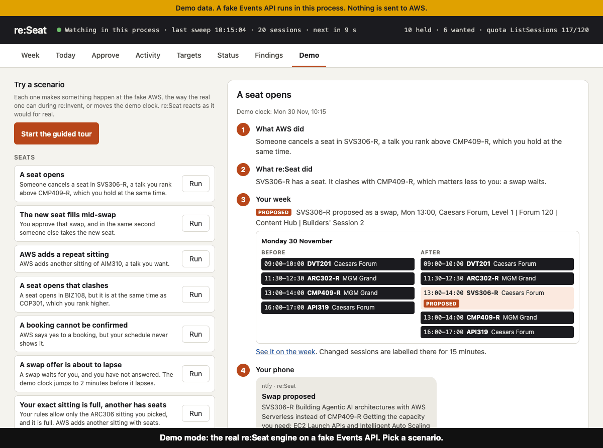
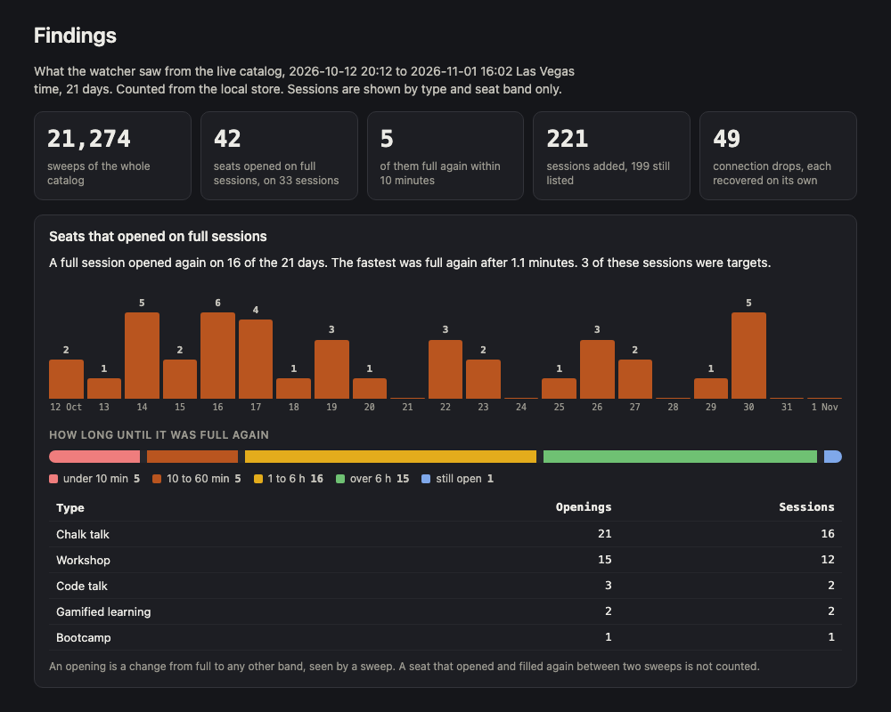
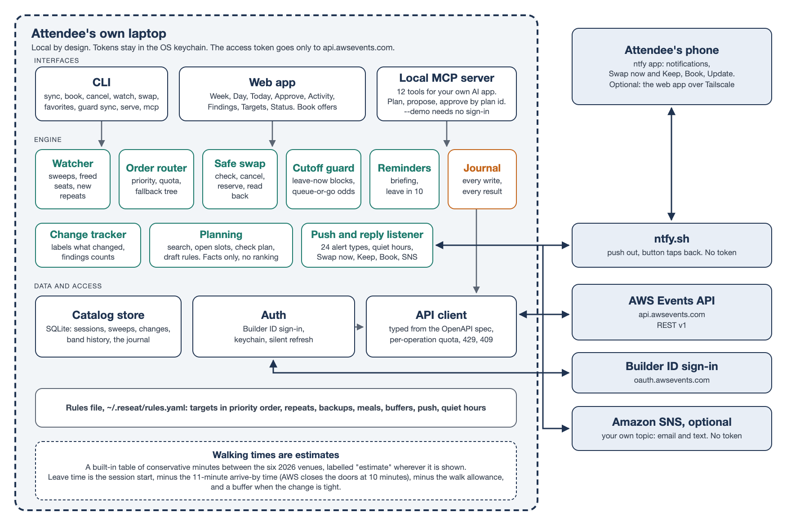

# re:Seat: your AI plans, re:Seat books the seats

Reserved seating for re:Invent 2026 opened on 6 October. By 1 November, 1,448 of the 1,483 sessions that take reservations were full. But seats come back. From 12 October to 1 November, full sessions opened again 42 times, on 16 of 21 days. Only 5 were full again within 10 minutes. Most, 32 of the 42, were not seen full again for an hour or more, measured to the next sweep that saw them full. The problem is that no person can watch every full session, all day.

re:Seat watches them for you. While your laptop is awake, it sweeps the whole catalog about once a minute and books a freed seat or a new repeat sitting inside your rules. It swaps you to a better sitting only after it has checked your way back. It tells you when to leave. Your plan is the input. Plan with the AI tool you already use, and the plan becomes a rules file that re:Seat follows. Your AI does the thinking, and re:Seat does the booking.

**Try it, no sign-in:** `uvx --python 3.12 reseat serve --demo`, then open `http://127.0.0.1:8491/`. Or open the [browser demo](https://hsiddhu2.github.io/reseat/).



## What happens every year

re:Invent 2025 drew [more than 60,000 attendees](https://www.aboutamazon.com/news/aws/aws-ceo-ai-inference-transforms-developer-capabilities).

- "A little secret, get in line and keep refreshing the app for the associated session." ([r/aws, 2022](https://www.reddit.com/r/aws/comments/yxsli3/aws_reinvent_reserved_seating/))
- It is "whack-a-mole night", because "no sooner have you tried to reserve a seat it’s quite likely that session will already be fully booked" ([Adam Divall, 2023](https://adamdivall.co.uk/article/reinvent/preparing-for-reinvent2023/)).
- "You will definitely fail to join the next session unless you have reserved and they're on the same building." ([r/aws, 2023](https://www.reddit.com/r/aws/comments/186kzmh/my_initial_impressionsfeedback_about_the_aws/))
- AWS's [FAQ](https://aws.amazon.com/events/reinvent/faqs/): "Look for repeated instances of sessions (indicated with -R in the session ID) or continue checking back for availability in that session."

## The planning problems, and what re:Seat does

| Problem | What re:Seat does |
|---|---|
| **A huge catalog.** "Just wait until you see the session catalogue - it's huge :)" ([r/aws, 2023](https://www.reddit.com/r/aws/comments/17lx1qa/aws_reinvent_confusing_venues/)) | `search_sessions` searches the local copy by text, type, day and venue. Nothing goes to AWS. |
| **Scattered repeats.** "I should be able to pull up details for a session and see ALL occurrences of that particular session." ([r/aws, 2024](https://www.reddit.com/r/aws/comments/1h6ustk/reinvent_2024_pet_peeves/)) | A target names a talk. re:Seat tries its sittings in your order, and with repeats on, any sitting AWS adds later. |
| **Hidden walks.** "you won’t make back to back sessions in eg Venetian and MGM.. it takes too long to move between them." ([r/aws, 2023](https://www.reddit.com/r/aws/comments/17lx1qa/aws_reinvent_confusing_venues/)) | `check_plan` flags clashes, two sittings of one talk and walks that miss the 11-minute door rule. |
| **Backups.** "I personally add some backup sessions in case I don't manage to book all my first choices." ([Jimmy Dahlqvist](https://jimmydqv.com/how-to-reinvent-ep-2-sessions/)) | Each target can list backups, tried in order. |
| **Favorites are not seats.** "A favorite is just a bookmark. Reserving is what actually holds you a spot." ([Dahlqvist](https://jimmydqv.com/how-to-reinvent-ep-3-reserved-seating/)) | re:Seat reserves the seat. `reseat favorites sync` adds your targets to your AWS favorites and never removes yours. |
| **The plan lives apart from the booking.** Dahlqvist keeps his picks in a text file. "Then I can copy & paste and search for sessions and just reserve them fast." ([Dahlqvist](https://jimmydqv.com/how-to-reinvent-ep-3-reserved-seating/)) | `draft_rules` writes your plan as a rules file. `reseat rules from-schedule` imports a plan built in the AWS portal. `reseat rules import` reads a JSON export from reinvent-planner.cloud, in its order. |

## The seat problems

- **Seats come back when nobody is looking.** 32 of the 42 openings were not seen full again for an hour or more.
- **There is no swap.** A reserve that clashes with a held seat is refused ([record](https://github.com/hsiddhu2/reseat/blob/main/docs/proof/2026-10-26-clash-refused.md)). You must cancel, then rebook.
- **You lose your seat at the door** if you are not there "at least ten minutes prior to the session start time" ([AWS FAQ](https://aws.amazon.com/events/reinvent/faqs/)).

## Plan with the AI tool you already use

AWS offers its Events API as a REST API and as "a Model Context Protocol (MCP) server, for AI assistants and agents" ([developer guide](https://docs.aws.amazon.com/events/latest/devguide/what-is-events-api.html)). re:Seat runs its own MCP server on your laptop with `reseat mcp`. It adds no model and no hosted service. You and your AI choose. re:Seat keeps the seats.

AWS warns that "an assistant can report 'done' when some sessions failed" ([guide](https://docs.aws.amazon.com/events/latest/devguide/mcp-server.html)). re:Seat's 12 tools work from your real catalog and schedule. Each write runs only through a plan id from an earlier call, so your AI app can show you the plan before it is approved. A plan id works once, expires after 10 minutes and is dropped when the rules file changes.

## What re:Seat does after the plan

**It books what opens.** A freed seat on a target, or a new repeat sitting, is booked inside your rules.

**It swaps safely.** It cancels held seat A for wanted seat B only when a fresh `GetSession` read shows B open with no clash, A has a way back, and you allowed it with a Swap now tap or `auto_swap: true`. If B is refused, it books A again, or another open sitting of A.

**It tells you when to leave.** re:Seat plans to 11 minutes before the start, as [one veteran advises](https://angelo.mandato.com/2025/08/16/ultimate-tips-aws-re-invent-2025/): "use 11 minutes as I have found myself arguing with the staff". It writes leave-now blocks into your official AWS schedule.

- **Queue or go.** For a talk you want but do not hold, it gives walk-up odds with a range, updated each time it sees the session fill. It is a heuristic, not a prediction ([models](https://github.com/hsiddhu2/reseat/blob/main/docs/models.md)).
- **On site.** During the day it checks the day's held and wanted sessions, up to 35 of them every 20 seconds, so a seat a no-show frees can be booked while you stand in the walk-up line.

## How it uses the API safely

- **No blind retry.** Reserve and cancel are not idempotent. A timeout is settled by reading your schedule back, never by resending. Every write is checked in `GetSchedule` and journaled.
- **A 200 can still hold per-session failures.** A reserve on full AIM353 came back HTTP 200 with `sessionFull` in `failed`. re:Seat recorded it as full and never resent it ([record](https://github.com/hsiddhu2/reseat/blob/main/docs/proof/2026-11-01-full-refused.md)).
- **Quota is per operation per minute.** Bulk calls count each session named, not each request. re:Seat sizes each batch to the quota left. On a 429 it waits `Retry-After` once, retries, and stops if refused again. After a 401 it refreshes the sign-in and resends once. A 429 writes nothing and spends no quota, so that one retry never repeats a write that landed.
- **Ask before a cancel,** unless you opted that target in.
- **An empty catalog is not trusted.** The API served no sessions from 8 to 12 October. A guard refuses an empty or half-missing sweep ([record](https://github.com/hsiddhu2/reseat/blob/main/docs/proof/2026-10-08-catalog-empty.md)).
- **Your token stays in your OS keychain** and goes only to `api.awsevents.com`.

It uses every operation of the Events API, 12 in all, from the sweep to the leave-now blocks.

## The proof

I am registered for re:Invent 2026. The watcher ran on my laptop against the live catalog, 12 October to 1 November ([full record](https://github.com/hsiddhu2/reseat/blob/main/docs/proof/2026-11-01-watcher-to-1-nov.md)):

- **21,274 sweeps** of the whole catalog. Sweeps came under 5 minutes apart for about 57 percent of the window, about 270 hours. The laptop slept some nights.
- **42 openings on 33 full sessions.** Counted as openings, not sessions: 21 on chalk talks, 15 on workshops, 3 on code talks, 2 on gamified learning and 1 on a bootcamp.
- **221 sessions added** after the catalog returned, and 56 removed.
- **49 connection drops recovered** on their own, with no write sent during them.



*What the watcher saw, 12 October to 1 November: openings per day, and how long until each was full again. "Targets" on this page means the current target list. None of those 3 sessions opened while it was a target.*

Live writes, read back:

- **25 October:** after a rules edit and restart, with nothing else typed or tapped, it booked the 2 targets that were already open and sent a push and an email for each ([record](https://github.com/hsiddhu2/reseat/blob/main/docs/proof/2026-10-25-autopilot-first-booking.md)).
- **25 and 26 October:** a swap from INV510-R1 to INV508-R1 and back, by hand in under 3 seconds each way ([record](https://github.com/hsiddhu2/reseat/blob/main/docs/proof/2026-10-25-live-swap-round-trip.md)), then by the watcher on its own in 6 seconds each way ([record](https://github.com/hsiddhu2/reseat/blob/main/docs/proof/2026-10-26-watcher-swap.md)).
- **25 October:** 15 leave-now blocks written and read back ([record](https://github.com/hsiddhu2/reseat/blob/main/docs/proof/2026-10-25-leave-now-blocks.md)).
- **1 November:** a reserve on full AIM353, refused inside a 200, never resent ([record](https://github.com/hsiddhu2/reseat/blob/main/docs/proof/2026-11-01-full-refused.md)).
- **1 November:** a swap approved with Swap now on the phone push, there and back, each verified. Cancel to verified took 2 seconds each way ([record](https://github.com/hsiddhu2/reseat/blob/main/docs/proof/2026-11-01-phone-swap-tap.md)).
- **1 November:** a rollback. A test script skipped the clash pre-check on purpose, to force a refusal after the cancel. The new seat was refused with `scheduleConflict` after the cancel. re:Seat reserved the old seat again 4 seconds after its cancel and read it back ([record](https://github.com/hsiddhu2/reseat/blob/main/docs/proof/2026-11-01-swap-rollback.md)).

Then the API changed. Personal time went from "Always UTC" in the 2 October spec to "wall-clock time in the event's own timezone, not UTC" in the 1 November copy. Blocks written in UTC sat 8 hours late until they were moved. re:Seat 1.0.0 followed the same day. `reseat guard sync` moved my 15 blocks and read them back ([changelog](https://github.com/hsiddhu2/reseat/blob/main/CHANGELOG.md), [API facts](https://github.com/hsiddhu2/reseat/blob/main/docs/api-facts.md), [journal counts](https://github.com/hsiddhu2/reseat/blob/main/docs/proof/2026-11-01-watcher-to-1-nov.md)).

## Built as a product

10 releases on [PyPI](https://pypi.org/project/reseat/) since 10 October, 1.0.0 on 1 November. 1,355 tests against a fake of the API, including a fault storm of full sessions, 429s, a 503 and writes switched off.

CI on Linux, macOS and Windows, CodeQL, pip-audit, Dependabot, 18 [design decisions](https://github.com/hsiddhu2/reseat/tree/main/docs/adr) and an MIT licence.



## Not seen live yet

A target seat caught at the moment it frees. Built and tested against the fake API. Three sessions on the current target list did open, all between 13 and 19 October, before they were added as targets ([record](https://github.com/hsiddhu2/reseat/blob/main/docs/proof/2026-10-30-watcher-to-30-oct.md)).

## Start before 30 November

```bash
pipx install reseat
reseat login
reseat serve
```

`reseat login` opens your AWS Builder ID sign-in. For the AI tools, install `reseat[mcp]` and follow the [MCP guide](https://github.com/hsiddhu2/reseat/blob/main/docs/guide/mcp.md).

Code on [GitHub](https://github.com/hsiddhu2/reseat), live records in [docs/proof](https://github.com/hsiddhu2/reseat/tree/main/docs/proof). Let re:Seat watch for your seats.
