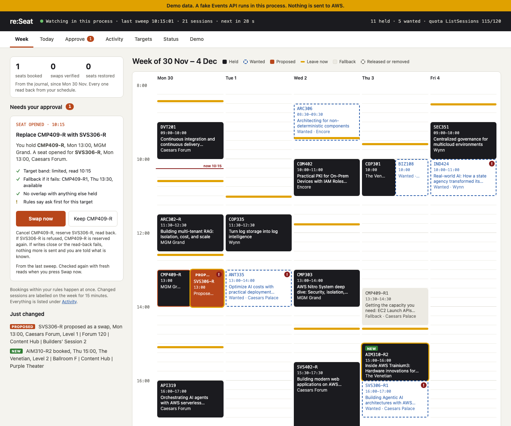
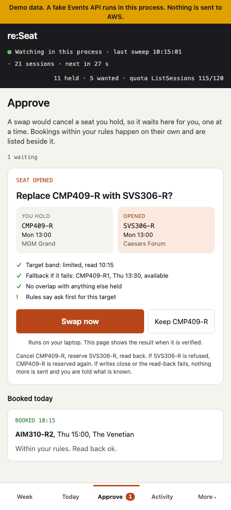
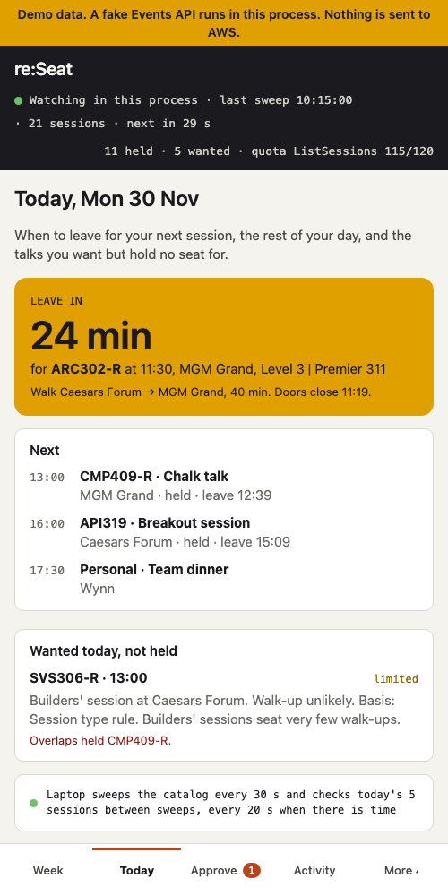
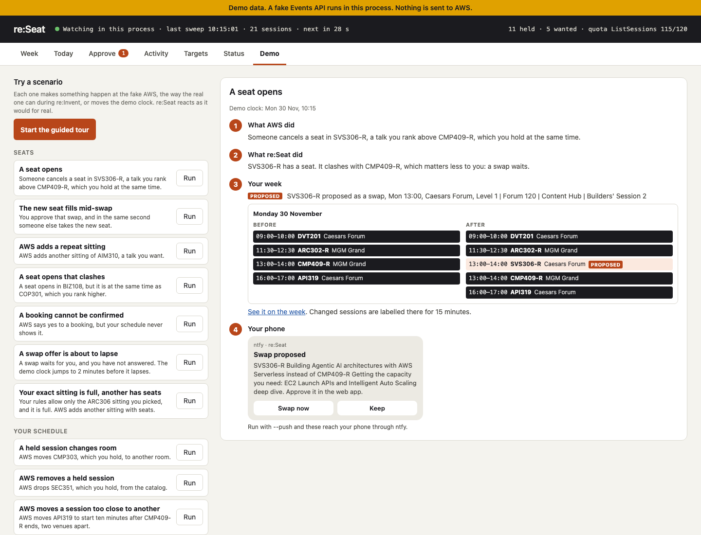

# re:Seat: the seats you missed, booked while you sleep

Planning your re:Invent week is the easy part. The hard part starts after the opening rush, when half your list is full and the only way to get in is to keep refreshing the app. I built re:Seat to do the refreshing for you. It is a small tool that runs on your laptop from the day the Events API opens for writes until the last session ends. It watches the catalog and books a seat within a minute of one freeing up or a new sitting being added. It upgrades a seat you hold to a better sitting, and only lets go of yours after a fresh read shows a way back in: your sitting, or another sitting of it, still open. And it tells you when to leave so you reach the room before the doors close. You approve a swap from a notification on your phone. It is built on the AWS Events API.

You can try it in two minutes without signing in to anything:

```
pip install reseat
reseat serve --demo
```

If you would rather not install it, open the [click-through demo](https://hsiddhu2.github.io/reseat/) in your browser.



## Why I built it

Here is what attendees have said about reserved seating over the last four years, from Reddit, blogs and Builder Center posts:

- "Most things were full by 10:03am." (2022)
- "Some stuff that was full yesterday I was able to reserve right now." (2024)
- "The more popular sessions get 2-3x extra sessions once they get booked up." (2022)
- "Get in line and keep refreshing the app for the associated session. Most of the sessions will have no shows or cancellations." (2022)
- "Use 11 minutes as I have found myself arguing with the staff." (2025)
- "Don't do one session at Venetian followed by a session at MGM. You'll never make it." (2022)

Two things stand out. Seats free up after opening day, and AWS adds repeat sittings for the popular sessions. The only way to catch either has been to refresh the app all week. re:Seat does the refreshing for you, and it acts only within rules you write.

## What the API does not give you

The Events API is clean and well documented. I want to call out four things it does not do, because they shape everything re:Seat does.

**There is no swap.** If you hold session A and a better session B opens at the same time, reserving B is refused with `scheduleConflict` and a `conflictsWith` list. You must cancel A first. For a moment you hold neither, and someone else can take A's seat.

**There is no search.** ListSessions returns the whole catalog in pages of 250. Everything else happens on your side.

**Availability is a band, not a count.** A session is `available`, `limited`, `veryLimited`, `unavailable` or `walkUp`. There is no seat count and no waitlist.

**Sign-in only works on your own machine.** OAuth with PKCE, a callback on a loopback port, no hosted redirect. A phone cannot sign in.

## How re:Seat handles each

### A safe swap

This is the part I spent the most time on. re:Seat cancels A only when three things hold:

1. **B is open** in a fresh GetSession read, takes reservations, and clashes with nothing else you hold.
2. **A has a fallback.** Its own band is open, or another known sitting of A is open, read fresh, and clashes with nothing else you hold.
3. **You approved it**, or allowed auto-swap for that target in your rules.

Then it cancels A, reserves B, and reads your schedule back. If B failed, it reserves A again. If A is gone too, it tries each fallback once, in order, and tells you exactly what you hold.

Three cases stop it with nothing more sent. If the cancel fails and A is still held, it stops before touching B. If a read-back fails, it says the state is unknown and asks you to check the schedule. If writes close at any point after the cancel, it says A was released and needs reserving again. Sending another write in any of these cases would be a blind retry, and that is the one thing the API documentation says never to do.

One swap runs at a time, across processes. Every swap state is journaled, rolled back and failed included, and each swap write is journaled before and after it is sent. Every other write is journaled with its response and the schedule read back.



### The whole catalog, and what changed in it

A full sweep is about 9 calls. re:Seat sweeps once a minute, without abstracts, and keeps the catalog in SQLite with the band history of every session. A move from `unavailable` to an open band is a freed seat. A session that was not there in the last sweep, under a code you want, is a new repeat. re:Seat books either the moment it sees it, inside your rules and the per-minute quota, and reads the result back.

### When to leave

When you ask it to, re:Seat writes a short personal-time block for each held session into your official schedule: leave at this time, walk from here to there. The leave time is the session start minus 11 minutes, which is when door staff stop admitting, minus enough time for the walk between the six 2026 venues to be done in time 80 percent of the time, and minus a buffer you set when the change is tight. The walk is an estimate, and walking speeds vary by about 19 percent from person to person, so a typical 40-minute walk gets 47 minutes. The Today page counts it down. When your holds change, the blocks are offered for update. They are never changed behind your back.



### One web app, one job per page

`reseat serve` runs the watcher and a local web app. Week shows any swap that needs you, with its checks, and the calendar, where whatever just changed is labelled: booked, swapped in, moved, released. Activity keeps every change and the journal of writes. Targets reads your rules back. Status shows the quota left this minute. A day opens in full from the week. At phone width, Approve shows one proposal at a time and Today shows when to leave.

`reseat serve --demo` runs all of this on a fake API with a scripted week and a Demo page of scenarios. Each scenario shows what AWS did, what re:Seat did, the week before and after, and the notification your phone would get.



### The laptop is the agent, the phone is the remote

The token never leaves the laptop. Your phone gets notifications through the free ntfy app: a morning briefing, leave in 10 minutes, leave now, a heads-up when a talk you want starts in 20 minutes, and a swap proposal. With `ntfy_approve: true` in your rules, the proposal carries Swap now and Keep buttons. A tap goes back through ntfy.sh to a topic derived from yours, and the laptop reads it over an outgoing connection. The phone never has to reach the laptop.

Each button carries a plan id that expires after 10 minutes and works once, and a made-up one costs nothing. ntfy.sh topics have no password, so the topic name is the secret. Someone who learns it can read the pushes (codes, titles, times, rooms, venues, the web app's Tailscale address if you use it, the button ids, never the token) and, with buttons on, approve or dismiss a swap re:Seat proposed or update its leave-now blocks, and nothing else. The README says how to rotate it.

### For agents

`reseat mcp` runs a local MCP server, so an agent can read your targets and plan changes. Every change is two steps: a propose returns a plan id and sends nothing, and an approve carries that plan out once, within 10 minutes. `reseat mcp --demo` runs the tools on the fake with no sign-in.

## Why re:Seat runs on your machine

The first question people ask is why there is no hosted version. The Events API signs you in with OAuth and PKCE, using your own Builder ID, through a callback on a loopback port of the machine you sign in on. It has no hosted sign-in. A hosted re:Seat would have to hold other attendees' tokens, and those tokens can cancel their seats. So re:Seat runs on your laptop, keeps your tokens in the OS keychain, sends the access token only to `api.awsevents.com` and the refresh token only to the sign-in service, `oauth.awsevents.com`. Your phone never holds either.


## Seen live

On the evening of 8 October, the day API writes were scheduled to open, I ran the band inspection I had planned for after seating opened. The API served no catalog.

```
ListSessions                -> 200, totalCount 0, items 0
GetSession <held session>   -> 404 "No session was found with the requested id"
GetSchedule                 -> 200, reserved 14, favorites 16
```

GetSession returned 404 even for the 14 sessions I held. The same condition was reported on 3 October in [a public GitHub issue](https://github.com/jasonwadsworth/reinvent-scout/issues/17) and in a post on the hackathon's discussion page.

re:Seat's first sync that evening read the empty answer as "every session removed" and emptied its local copy. It sent no write. Since then, an empty or short catalog is refused and the local copy kept, a catalog of new ids is a new starting point rather than thousands of new sessions, and nothing is booked while a held session is missing from the local copy, so a second sitting of a held talk can never be booked by mistake.

The record is in [proof/2026-10-08-catalog-empty.md](proof/2026-10-08-catalog-empty.md), with one line for each daily check since.

The catalog stayed empty through 11 October. On 12 October it came back with 2,227 sessions and their seat bands. Six days after reserved seating opened, 1,115 of the 1,460 sessions that take reservations were already full. That one number is why re:Seat exists. Session ids survived the outage, and 13 sessions changed their code under the same id, so a target pinned by id followed them. On 8 October I wrote that the id ranges suggested the catalog had been re-keyed. It had not, and the proof file carries a dated correction of the id facts behind that guess.

The first live write check turned up a difference from the spec. A cancel on a session you do not hold is documented as 404. The live API answered 400 "The request could not be applied to this session". re:Seat's probe stopped with an error on it. It now reads 400 or 404 as writes open, with a test for each.

Then the real check: reserve a repeat sitting I did not want, read the schedule back, cancel it, read it back. Twice.

```
22:32:57 PDT  ReserveSessions    AMZ202-R1  success    read back: 15 reserved, AMZ202-R1 held
22:33:19 PDT  CancelReservation  AMZ202-R1  cancelled  read back: 14 reserved, AMZ202-R1 not held
22:40:06 PDT  ReserveSessions    AMZ202-R1  success    read back: 15 reserved, AMZ202-R1 held
22:47:16 PDT  CancelReservation  AMZ202-R1  cancelled  read back: 14 reserved, AMZ202-R1 not held
```

The second time I kept the seat long enough to see it in the AWS portal before cancelling. Nothing else in my schedule changed. Writes are open, and each booking and cancel was read back. The records are in [proof/2026-10-12-catalog-returned.md](proof/2026-10-12-catalog-returned.md) and [proof/2026-10-12-round-trip.md](proof/2026-10-12-round-trip.md). A swap, a booking caught by the watcher, and a full or clashing session have not happened live yet. They are tested against the fake.

## How it was tested

Every write path runs against an in-process fake that produces each failure the API documents, from partial bulk results and `scheduleConflict` to 409, 429 with `Retry-After`, 5xx, dropped connections and an expired sign-in. A fault storm runs the whole flow for an hour on the 2,006 timed sessions of the catalog I pulled on 1 October, with 30 percent of reserves full, a 429 every minute, a 503 and fifteen minutes of 409 under the real quotas, and checks that no quota is exceeded, no talk is held twice and every write is read back. The suite has 845 tests, and CI runs them on Linux, macOS and Windows. The storm found two bugs: the watcher proposed swaps that could never run, and re-sent writes every minute into a 409. A third turned up before it could lose a seat: a timeout while reserving B, after A was cancelled, escaped the rollback. I fixed it in the client, so every write path inherits the fix.

## What is a heuristic

I want to be honest about which parts are rules and which are guesses.

- **Queue or go.** Odds with a range, not a yes or no. The rule for the session type is the starting point: breakouts usually admit walk-ups, chalk talks need you early, workshops and builders' sessions admit almost none. Each time re:Seat sees the session fill and free a seat again, the odds move, so the page reads "walk-up about 47% (23 to 71%)". The range is wide until there is data. It is never a prediction, and the page always shows its basis.
- **Walking times.** Conservative estimates between the six 2026 venues, not official figures. Every screen, push and leave-now block says "estimate". AWS publishes no walking or shuttle times, so re:Seat adds none of its own.
- **Wynn and Encore** arrive from the API as one venue, `Wynn/Encore`. re:Seat splits them by room name.
- **Booking order.** Formats that are not recorded fill first, so they are sent first: workshops, labs and bootcamps, then builders' sessions, chalk talks, code talks, breakouts. I also tried the textbook alternative, value times fill speed, on the fault storm. Over ten seeds it made no real difference, so I kept the simpler rule. The details are in [the models page](models.md).

## Limits

- It manages seats you already chose. For choosing, use the AWS portal or a planner. re:Seat reads your official schedule, or imports reinvent-planner.cloud exports.
- It cannot help with the opening rush. Reserved seating opened in the AWS portal on 6 October, two days before API writes were due to open, and until then reserve and cancel return 409.
- The web app is plain HTTP. If you open it on the phone, do it over Tailscale.
- The ntfy topic name is the secret. Make it long and random, and rotate it if it leaks.
- It is designed for a laptop left in the hotel room, plugged in and awake.
- The MCP server tells an agent to ask before approving, but cannot check that it did.

## Wrapping up

re:Seat does three things, all week, within rules you wrote: it books the seats you could not get, it upgrades the ones you hold only after checking there is a way back in, and it gets you to the room on time. It tells you what it did and why. The code, the proof files and the demo are all in the repo. If you are attending re:Invent 2026, install it, point it at your schedule, and let me know what it catches for you.

- Code: [github.com/hsiddhu2/reseat](https://github.com/hsiddhu2/reseat)
- On AWS Builder Center: [re:Seat: the seats you missed, booked while you sleep](https://builder.aws.com/project/3KZhHk8a0XfKPUaIdZUTKjSLoZ4/reseat-the-seats-you-missed-booked-while-you-sleep)
- Install: [pypi.org/project/reseat](https://pypi.org/project/reseat/)
- How it works: [docs/architecture.md](architecture.md)
- The models behind it, with sources: [docs/models.md](models.md)
- API facts it relies on: [docs/api-facts.md](api-facts.md)
- Live proof: [docs/proof](proof/)
- Demos: [demo](../demo/)
- Click-through demo: [hsiddhu2.github.io/reseat](https://hsiddhu2.github.io/reseat/)

re:Seat is built for the AWS re:Invent 2026 Event Catalog API Builder Challenge, on the AWS Events API.
